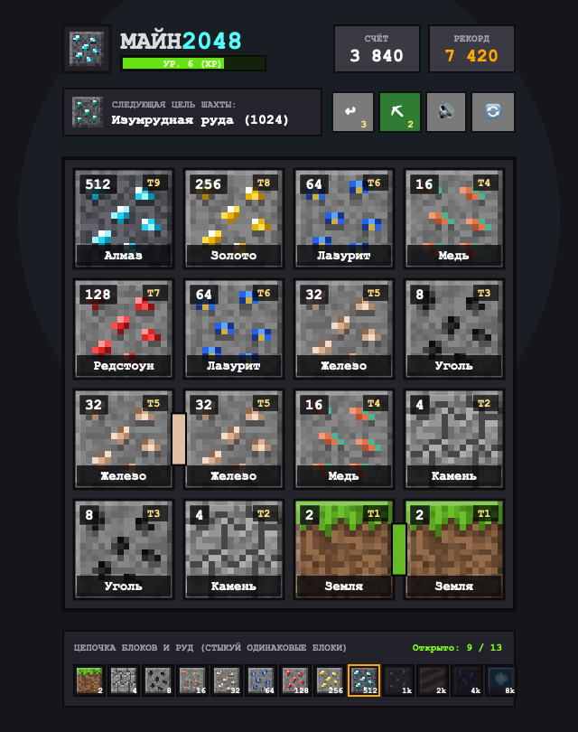
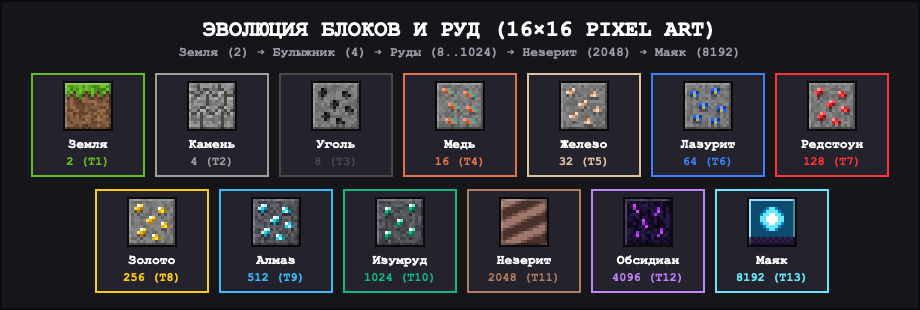

# ⛏ МАЙН2048 v2.0: Шахтёрский Рогалик (Balatro × Minecraft) & Аркада

Браузерная головоломка в жанре **2048** в сеттинге блоков, руд и мобов **Minecraft** с двумя режимами игры:
1. **⚔️ СЮЖЕТНЫЙ РОГАЛИК (в духе Balatro):** сражения с 10 уникальными мобами и боссами + бесконечный режим **«Бездна (Анте+)»** на рекорд, множители очков (`×Mult`), пассивные Чары на забег и **Сквозной Сундук одноразовых предметов**, которые сохраняются между играми!
2. **♾ БЕСКОНЕЧНАЯ АРКАДА:** классический медитативный режим раскопок без лимита ходов.

Одинаковые блоки на соседних клетках визуально **стыкуются друг с другом** цветным пиксельным швом и при свайпе сливаются в более редкую породу — от обычной земли и булыжника до алмазов, изумрудов, древних обломков незерита и маяка Звезды Незера.

---

## 📸 Скриншоты

### Игровой процесс и интерфейс
<p align="center">
  
</p>

### Полная цепочка эволюции блоков и руд (16×16 Pixel Art)
<p align="center">
  
</p>

---

## ⚔️ Режим «Сюжетный Рогалик» (Кампания + Бездна Анте+)

Поле `4×4` **сохраняется между врагами** на протяжении всего забега: собранные руды остаются на доске, поэтому игроку нужно балансировать между крафтом дорогих блоков и удержанием свободного места под требования следующего моба.

### Бестиарий и условия победы
| Этап | Враг / Босс | Лимит ходов | Условие победы и способности |
| :--- | :--- | :--- | :--- |
| **1** | 🐔 **Курица** | `14` | Держать на поле блок **Угля (8)** или выше |
| **2** | 🧟 **Зомби** | `16` | Держать **Медь (16+)** и набрать `70` очков в бою |
| **3** | 🕷 **Пещерный Паук (Босс)** | `18` | Набрать `120` очков, удерживая **≥ 8 пустых клеток** (половина поля!) |
| **4** | 💀 **Скелет** | `17` | Сделать `4` слияния в бою и держать **Железо (32+)** |
| **5** | 🟢 **Слайм** | `18` | Набрать `220` очков и освободить **≥ 8 пустых клеток** |
| **6** | 💥 **Крипер (Босс)** | `20` | Держать **Лазурит (64+)** и `360` очк. *(Каждые 4 хода кидает Камень 4 на поле)* |
| **7** | 🔮 **Ведьма** | `20` | Сделать `5` слияний в бою и держать **Редстоун (128+)** |
| **8** | 🔥 **Ифрит Незера** | `22` | Держать **Золото (256+)** и набрать `650` очков в бою |
| **9** | 🟣 **Эндермен (Босс)** | `24` | Набрать `1000` очк. при **≥ 6 пустых клетках** *(Каждые 3 хода меняет блоки местами)* |
| **10** | 🐉 **Дракон Края (Финал)** | `26` | Держать **Алмаз (512+)** и набрать `1800` очк. *(Телепортирует блоки и спавнит породу)* |
| **11+** | ☠️ **Бездна (Анте+)** | `20–28` | Бесконечное масштабирование требований (`×1.45` за уровень) для игры на рекорд |

---

## 🎒 Сквозной Сундук Предметов (не теряется между играми!)

С каждого побеждённого моба с шансом (и со **100% гарантией с Боссов**) выпадают одноразовые артефакты. Они сохраняются в `localStorage` даже после поражения и могут быть использованы в следующем забеге:

- 🟣 **Жемчуг Эндера** — мгновенно скипнуть текущего врага и забрать награду за этап.
- 🧨 **Шашка ТНТ (Динамит)** — взорвать всю мелкую породу (`Земля 2` и `Камень 4`) на поле, освободив клетки (спасает против Паука и Слайма).
- 🧪 **Зелье Двойного Стака (`×2 Стак`)** — следующие `3` слияния прыгают сразу через тир (`×4` вместо `×2`, например `16 + 16 = 64`) и дают `×2.0 Mult`.
- 🔨 **Алмазная Наковальня** — позволяет кликнуть по любому блоку на поле и мгновенно удвоить его тир (`×2`) без пары.
- 🍎 **Золотое Яблоко** — мгновенно добавляет `+8` ходов к таймеру текущего боя.
- 🛡 **Тотем Бессмертия (Авто)** — автоматически срабатывает при поражении (когда закончились ходы или забилось поле), расчищая мелкие блоки и давая `+8` ходов.

---

## 🃏 Пассивные Чары Забега (Множители Balatro `×Mult`)

Каждые 2 этапа и после каждого Босса игрок выбирает **1 из 3 Чар** до конца текущего забега:
- **🌌 Эхо Пустоты** — `×1.8 Mult`, когда на поле свободно `≥ 7` клеток.
- **💎 Алмазный Азарт** — `+0.4×` к множителю за каждый блок руды `≥ 64` на поле.
- **⛏ Мастер-Геолог** — вместо Земли (`2`) на поле всегда спавнится сразу Камень (`4`) или Уголь (`8`).
- **⏳ Песочные Часы** — каждый новый враг даёт `+4` дополнительных хода и `×1.3 Mult`.
- **⚡ Цепная Реакция** — двойное слияние за 1 свайп возвращает `+1 ход` и даёт `×1.6 Mult`.
- **🎁 Удачливый Мародёр** — `100%` шанс выпадения предмета в Сундук с каждого моба и `×1.4 Mult`.

---

## 💎 Таблица прогрессии блоков и руд

| Значение | Тир | Блок / Руда | Описание текстуры |
| :--- | :--- | :--- | :--- |
| **2** | `T1` | 🌱 **Земля** | Блок земли с зелёной шапкой травы и пиксельной бахромой |
| **4** | `T2` | 🪨 **Камень** | Классический булыжник с фактурной сеткой трещин |
| **8** | `T3` | ⚫ **Уголь** | Угольная руда в каменной породе |
| **16** | `T4` | 🟠 **Медь** | Медная руда с оранжевыми и окисленными бирюзовыми прожилками |
| **32** | `T5` | 🧱 **Железо** | Железная руда с бежево-металлическими вкраплениями |
| **64** | `T6` | 🔵 **Лазурит** | Лазуритовая руда с густыми синими пятнами и золотой искрой |
| **128** | `T7` | 🔴 **Редстоун** | Редстоуновая руда с ярко-алыми рубиновыми жилами |
| **256** | `T8` | 🟡 **Золото** | Золотая руда с сияющими самородками |
| **512** | `T9` | 💎 **Алмаз** | Алмазная руда в глубинном сланце (`Deepslate`) |
| **1024** | `T10` | 🟢 **Изумруд** | Изумрудная руда с огранёнными зелёными кристаллами |
| **2048** | `T11` | 🟫 **Незерит** | Древние обломки (`Ancient Debris`) со слоистой бронёй |
| **4096** | `T12` | 🟣 **Обсидиан** | Плачущий обсидиан с неоново-фиолетовыми потоками |
| **8192** | `T13` | 🌟 **Маяк** | Маяк со светящимся ядром Звезды Незера на обсидиановом постаменте |

---

## 🚀 Быстрый запуск локально

```bash
git clone https://github.com/dmsznv-dot/mine2048.git
cd mine2048
python3 -m http.server 8088
```

Откройте в браузере: `http://localhost:8088`
